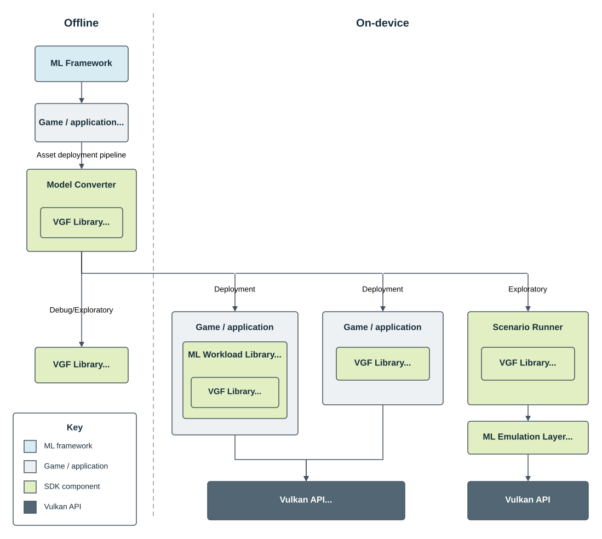

Introduction
============

The |SDK_project| is a collection of libraries and tools consisting of various components:

• :ref:`ML Emulation Layer for Vulkan®`
• :ref:`ML SDK Model Converter`
• :ref:`ML SDK Scenario Runner`
• :ref:`ML SDK VGF Library`
• :ref:`ML Workload Library for Vulkan®`

The following figure shows how you can use each of the ML SDK for Vulkan® components in a larger system:

r and emulation. A key identifies framework, application, SDK and Vulkan API boxes.

   Offline model preparation and on-device integration. Nested boxes show library
   use. Emulation is shown on the exploratory path; an application may also enable
   it through the Vulkan® layer mechanism. Click the diagram to inspect it at full size.

Each component has a distinct role:

**Emulation layer**
    Implements supported ML graph and tensor features using Vulkan® compute,
    exposed through the Vulkan® layer mechanism.

**Model Converter**
    Converts exported TOSA models into graph modules and optional custom compute
    modules, packaged with resource metadata and constants in a VGF asset.

**Scenario Runner**
    Explores and validates workloads described in JSON scenarios or constructed
    through C++ and Python APIs, collecting outputs and diagnostics.

**VGF Library**
    Encodes, decodes, inspects, and migrates VGF containers. It provides C++, C,
    and Python APIs without executing Vulkan® work.

**Workload Library**
    Provides a C++ runtime API for VGF-backed or standalone compute and
    data-graph workloads, with helpers for Vulkan® context, resources, and execution.

See :ref:`sdk-architecture` for component boundaries, resource ownership,
optional dependencies, and native or emulated execution paths.

In addition to these components, you will find documentation, tutorials, samples, and tests.

Production
----------

The model-based production workflow involves integrating the ML SDK Model Converter into the
application or game :code:`asset deployment pipeline`. The pipeline needs a TOSA intermediate
representation of a framework specific native model file. To obtain a TOSA intermediate
representation, use a framework-specific exporter or converter (the external
export step in the figure).
For example:

- `TOSA converter for TFLite <https://gitlab.arm.com/tosa/tosa-converter-for-tflite>`_
- `ExecuTorch <https://github.com/pytorch/executorch>`_

The TOSA intermediate representation is then passed to the ML SDK Model Converter
to produce a :code:`.vgf` file. The VGF file contents can then be:

• Embedded into the game or application's native packaging format.
• Distributed as a file on disk as part of the normal platform specific application deployment flow.

.. tip::
    Model Converter accepts TOSA FlatBuffer or MLIR input. Framework-specific
    export happens before this step. For exploration, Scenario Runner can load
    the resulting VGF asset through a scenario; VGF Dump can generate a scenario
    template. See the :doc:`VGF execution tutorial <vgf_run_tutorial>`.

The application or game running on the device can choose the integration level
that fits its Vulkan® architecture:

• Integrate the ML Workload Library for Vulkan® for workload execution support.
• Integrate the ML SDK VGF Library decoder directly for application control over
  translating VGF metadata into Vulkan® resources, pipelines, and commands.

In the direct decoder path, the application owns Vulkan® allocation,
synchronization, and session management; VGF Library only reads the container.

Exploration
-----------

Use Scenario Runner to explore a use case declaratively before integrating it
into an application. VGF Dump can extract container contents and generate a
scenario template, as shown in the :doc:`VGF execution tutorial <vgf_run_tutorial>`.
Workload Library samples then demonstrate C++ integration with VGF or standalone
workloads and application-owned Vulkan® contexts.

Scenario Runner uses Workload Library for direct compute dispatches. Its current
VGF dispatch constructor follows a separate legacy execution path. Scenario
Runner retains resource ownership, outer command recording and submission.

.. tip::
    The ML Emulation Layer for Vulkan® supports functional exploration when
    enabled through the Vulkan® layer mechanism. Native and emulated paths
    depend on the features supported by the selected Vulkan® implementation;
    emulation still requires an underlying Vulkan® implementation. See
    :ref:`Vulkan® implementation and emulation` for layer scope and capability
    requirements.

Platforms
---------

This table represents the status of platform support: supported (|/|), unsupported (|x|) and not applicable (|-|).
We will increase support in the upcoming releases.

.. rst-class:: support-matrix

+--------------------+-----------+-----------+----------+----------+-----------+
| Platforms          | Emulation | Model     | Scenario |  VGF     | Workload  |
|                    | Layer     | Converter | Runner   |  Library | Library   |
+==========+=========+===========+===========+==========+==========+===========+
| Linux    | AArch64 | |/|       | |/|       | |/|      | |/|      | |/|       |
+          +---------+-----------+-----------+----------+----------+-----------+
|          | X86-64  | |/|       | |/|       | |/|      | |/|      | |/|       |
+----------+---------+-----------+-----------+----------+----------+-----------+
| Windows® | AArch64 | |x|       | |x|       | |x|      | |x|      | |x|       |
+          +---------+-----------+-----------+----------+----------+-----------+
|          | X86-64  | |/|       | |/|       | |/|      | |/|      | |/|       |
+----------+---------+-----------+-----------+----------+----------+-----------+
| Darwin   | AArch64 | |/| *     | |/|       | |/| *    | |/|      | |/| *     |
+          +---------+-----------+-----------+----------+----------+-----------+
|          | X86-64  | |x|       | |x|       | |x|      | |x|      | |x|       |
+----------+---------+-----------+-----------+----------+----------+-----------+
| Android™ | AArch64 | |/| **    | |-|       | |/| **   | |/| **   | |/| **    |
+          +---------+-----------+-----------+----------+----------+-----------+
|          | X86-64  | |x|       | |-|       | |x|      | |x|      | |x|       |
+----------+---------+-----------+-----------+----------+----------+-----------+

\*  Experimental |SDK_project| support via MoltenVK or KosmicKrisp.
See :ref:`darwin-support` for
prerequisites, driver selection, and current limitations.

\** Initial Experimental support on Android™.

See details of limitations in the "Known Limitations" section of each component.

Tensor Data Types
-----------------

This table summarizes single-channel tensor element formats that are currently
handled by the ML Emulation Layer for Vulkan®, ML SDK Model Converter,
ML SDK Scenario Runner, and ML Workload Library for Vulkan®.

The ML SDK VGF Library is not listed because it stores encoded tensor format
metadata without adding data type-specific validation rules.

This table represents the status of tensor data type support: supported (|/|)
and unsupported (|x|).

.. rst-class:: support-matrix

+--------------------+-----------+-----------+----------+----------+
| Tensor data type   | Emulation | Model     | Scenario | Workload |
|                    | Layer     | Converter | Runner   | Library  |
+====================+===========+===========+==========+==========+
| bool               | |/|       | |/|       | |/|      | |/|      |
+--------------------+-----------+-----------+----------+----------+
| uint8              | |/|       | |/|       | |/|      | |/|      |
+--------------------+-----------+-----------+----------+----------+
| int8               | |/|       | |/|       | |/|      | |/|      |
+--------------------+-----------+-----------+----------+----------+
| uint16             | |/|       | |/|       | |/|      | |/|      |
+--------------------+-----------+-----------+----------+----------+
| int16              | |/|       | |/|       | |/|      | |/|      |
+--------------------+-----------+-----------+----------+----------+
| uint32             | |/|       | |/|       | |/|      | |/|      |
+--------------------+-----------+-----------+----------+----------+
| int32              | |/|       | |/|       | |/|      | |/|      |
+--------------------+-----------+-----------+----------+----------+
| int64              | |/|       | |/|       | |/|      | |/|      |
+--------------------+-----------+-----------+----------+----------+
| float16            | |/|       | |/|       | |/|      | |/|      |
+--------------------+-----------+-----------+----------+----------+
| float32            | |/|       | |/|       | |/|      | |/|      |
+--------------------+-----------+-----------+----------+----------+
| BFloat16           | |/|       | |/|       | |/|      | |/|      |
+--------------------+-----------+-----------+----------+----------+
| Float8E4M3         | |/|       | |/|       | |/|      | |/|      |
+--------------------+-----------+-----------+----------+----------+
| Float8E5M2         | |/|       | |/|       | |/|      | |/|      |
+--------------------+-----------+-----------+----------+----------+

The Emulation Layer column reflects the tensor layer and the shared tensor
format handling used by the graph layer.

The Model Converter column reflects the VGF tensor formats it can emit after
lowering.

The Scenario Runner preserves the payload bytes for BFloat16 and the
Float8 encodings when reading and writing NumPy files, rather than converting
them to native NumPy floating-point scalar types.

The Workload Library represents these formats in its resource model and uses
them when creating Vulkan® tensor descriptions, allocations, and views. Actual
execution depends on the workload and the formats supported by the target
Vulkan® implementation.

Refer to :ref:`JSON Test Description Specification` for detailed Scenario
Runner data type support information.
